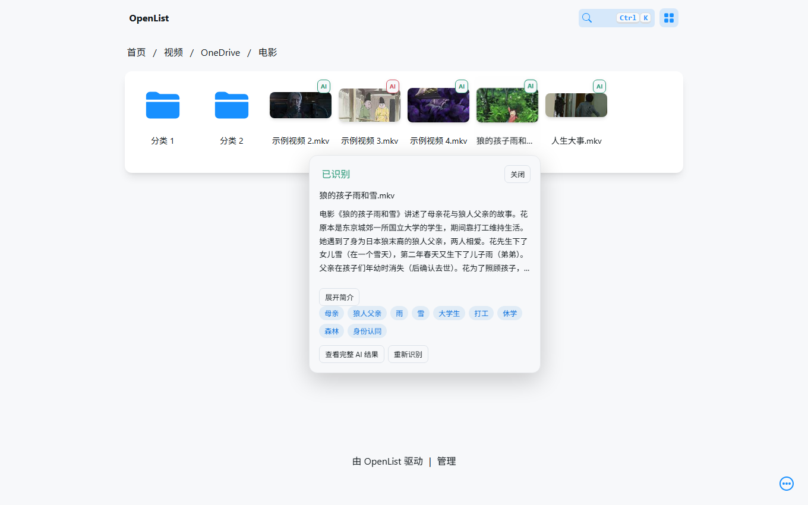
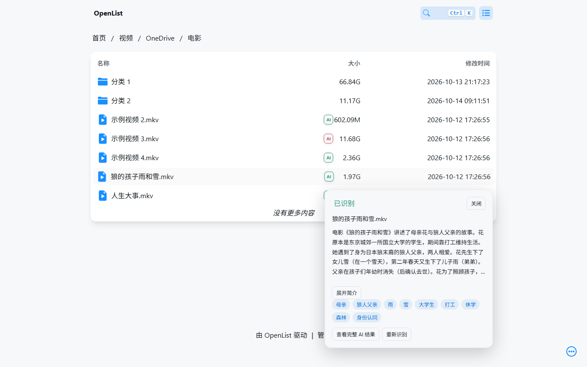
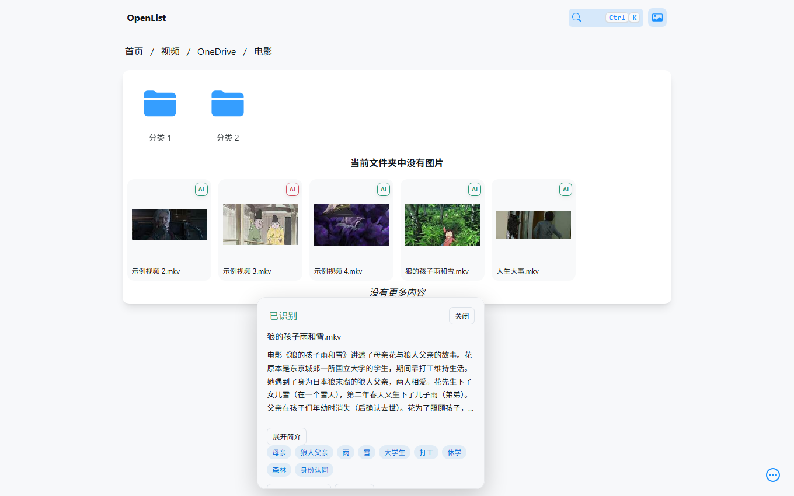
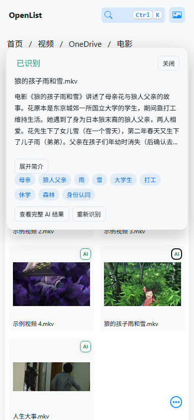
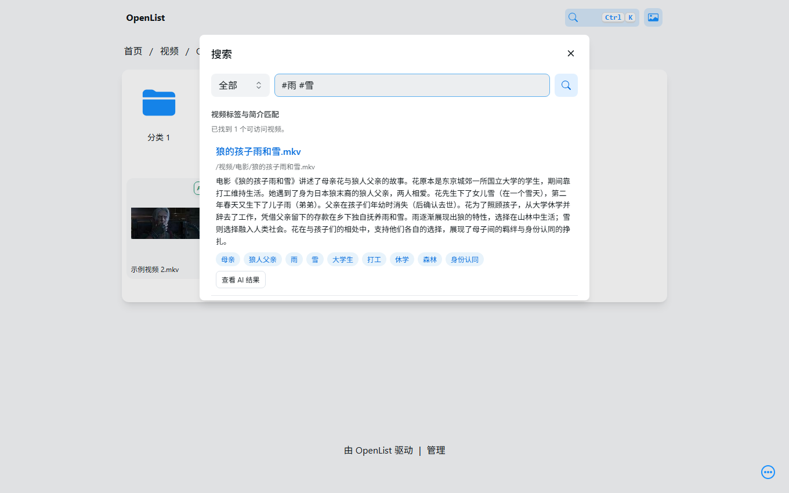
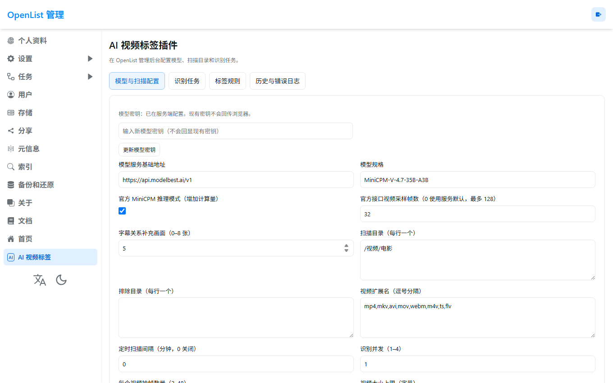

# OpenList AI 视频智能标签

[](https://github.com/imHansiy/openlist-ai-tags/actions/workflows/test.yml)
[](https://github.com/imHansiy/openlist-ai-tags/releases)
[](LICENSE)

在 **OpenList 原文件管理界面**中，为视频添加中文简介、内容标签和识别状态。使用 MiniCPM-V 4.7 理解真实视频，支持字幕联合分析；文件、播放、挂载和账号仍由 OpenList 管理。

**使用在线模型即可，无需本地 GPU，Docker 也不是必选项。** 本项目是第三方伴随服务与前端增强，需要在现有 OpenList 旁部署 Python 服务并接入同源 `/ai/`，不是上传一个压缩包即可启用的官方插件。

已在实际 OpenList、OneDrive、FreeBSD 与 ModelBest 在线 1B / 35B-A3B 环境联调。当前为 `0.1.0` 首版；Docker 启动、本地 GPU 推理、所有存储驱动及大规模性能尚未全部实测，识别也可能出现剧情或人物细节误判。[查看验证记录](docs/VERIFICATION.md)。

**快速导航**：[实际截图](#实际界面) · [部署方式](#选择部署方式) · [首次使用](#首次配置与使用) · [备份与卸载](#数据备份和卸载) · [常见问题](#常见问题)

## 实际界面

下面来自真实部署的截图，**站点标识、目录和资源文件名已脱敏，AI 内容保留原结果**；不是静态设计图。截图仅展示功能，不表示示例剧情完全准确。

### 网格视图与悬浮卡片

鼠标移到视频上显示悬浮卡片，查看简介、全部标签及识别操作，不再撑高文件列表。



<details>
<summary>展开查看列表、图片视图和手机效果</summary>

**列表视图**：保持原有大小、修改时间等列，AI 信息显示在浮层。



**图片视图**：复用原目录返回的数据补充视频卡片，保留原生图片与目录展示。



**手机端**：点击小型 AI 标记打开信息卡片。



</details>

### 原生搜索

使用 OpenList 自带的搜索按钮或 **Ctrl+K**，同一个输入框查文件名、AI 标签与简介；`#雨 #雪` 表示两个标签同时匹配。



### 原生管理后台

进入 **`/@manage` → AI 视频标签**，配置模型和扫描目录，查看任务、标签规则与日志。首页不显示额外管理工具栏。



## 功能一览

| 能力 | 当前实现 |
|---|---|
| 视频理解 | MiniCPM-V 4.7 1B / 35B-A3B；默认整段压缩 MP4 一次提交，生成中文简介与标签 |
| 电影分析 | 可结合文本字幕 / 画面 OCR、人物关系和补充清晰画面复核；支持证据缓存 |
| 原生界面 | 列表、网格、图片三视图悬浮卡片，手机点击、深浅模式、原文件菜单增强 |
| 搜索筛选 | 原生搜索内匹配标签 / 简介、多标签 AND、当前目录递归或根目录跨挂载检索 |
| 自动发现 | 手动扫描配置目录、定时增量扫描、变化检测、已完成跳过 |
| 任务队列 | 持久化、暂停 / 恢复 / 取消、失败重试、重启恢复、历史与错误日志 |
| 标签管理 | AI / 人工标签区分、隐藏标签、同义词、常用标签；重新识别保留人工覆盖 |
| 权限与数据 | 逐文件校验当前 OpenList 用户权限；SQLite 存储、一致性备份；不改视频和文件名 |

可靠文件哈希存在时可复用移动 / 改名后的结果；只有大小和时间相同不会直接合并。普通用户可查看有权限的视频结果；扫描、编辑公共标签和配置限管理员。

## 安装前准备

| 项目 | 要求或说明 |
|---|---|
| OpenList | 已部署、登录与挂载正常；UI 适配随版本可能变化，升级前需回归 |
| 管理身份 | 推荐长期管理员 API token；也支持管理员账号密码，交互式二步验证需改用 token |
| 模型 | 自己申请的在线 API key，或实际兼容该模型和视频输入的推理服务 |
| Python | 3.11+，推荐 3.12；Docker 方式自带 Python |
| 视频处理 | FFmpeg / ffprobe；字幕画面 OCR 另需 Tesseract 与 `chi_sim` 字库 |
| 网络 | 服务端能连接 OpenList、网盘下载域名和模型 API；浏览器不直连模型 |
| 存储 | 持久数据目录，以及视频压缩临时空间；默认中间文件预算 512 MiB / 任务 |
| 前端接入 | 同一 OpenList 域名下的 `/ai/` 路由，以及一次脚本注入；下文提供两种接入方式 |

一次识别通常会读取源视频的大部分或全部内容。23 MiB 是**发给模型的压缩副本**预算，不是网盘源文件读取流量。请先用一个短视频完成部署验收，再扩大扫描范围。

## 选择部署方式

| 你的环境 | 从哪里开始 |
|---|---|
| Linux / NAS，已有 Python 与反向代理 | [方案 A：Python + 原域名接入](#方案-apython--原域名接入) |
| 已有 Docker，希望用附带网关 | [方案 B：Docker Compose](#方案-bdocker-compose) |
| FreeBSD / Serv00，无 sudo | [专用安装教程](docs/FREEBSD.md) |
| Windows 或仅想先本机体验 | [方案 C：本机评估网关](#方案-c本机评估网关) |

这些方式只需选一种。**`OPENLIST_URL` 必须指向原 OpenList，不能指回 AI 网关自身。**

## 方案 A：Python + 原域名接入

适合保留现有域名、反向代理和 OpenList 部署。以下以 Python 已为 3.11+ 的 Debian / Ubuntu 为例。

### 1. 下载与安装依赖

```bash
sudo apt-get update
sudo apt-get install -y git python3 python3-venv ffmpeg
# 只有需要从画面识别字幕时才安装：
sudo apt-get install -y tesseract-ocr tesseract-ocr-chi-sim

git clone https://github.com/imHansiy/openlist-ai-tags.git
cd openlist-ai-tags
python3 --version
python3 -m venv .venv
.venv/bin/python -m pip install .
cp .env.example .env
chmod 600 .env
mkdir -p data
chmod 700 data
```

没有 sudo 的环境可复用主机已有依赖；FreeBSD 请使用[对应教程](docs/FREEBSD.md)。也可从 [Releases](https://github.com/imHansiy/openlist-ai-tags/releases) 下载完整源码 ZIP。wheel 只包含 Python 包和前端资源，部署模板、脚本和本文以源码仓库为准。

### 2. 编辑 `.env`

下面是在线 35B-A3B 的示例，替换地址和凭据，不要原样保留占位符：

```dotenv
# 原 OpenList 直连地址，不是新增的 AI 服务端口。
OPENLIST_URL=http://127.0.0.1:5244
OPENLIST_TOKEN=替换为管理员API令牌
# 使用 token 时账号密码可以留空。
OPENLIST_USERNAME=admin
OPENLIST_PASSWORD=

# 海外模型平台示例；国内平台改用 https://api.modelbest.cn/v1
MODEL_BASE_URL=https://api.modelbest.ai/v1
MODEL_NAME=MiniCPM-V-4.7-35B-A3B
MODEL_API_KEY=替换为当前平台的模型密钥
MODEL_NATIVE_VIDEO=true

# 按挂载实际返回的下载 / CDN 域名配置，不要填 *。
MEDIA_ALLOWED_HOSTS=*.sharepoint.com,*.1drv.com
AI_PROXY_ENABLED=false
```

没有管理员 token 时，将 `OPENLIST_TOKEN` 留空，并填写管理员账号与密码，服务会登录并刷新身份。密钥与账号不会发给浏览器。

`MEDIA_ALLOWED_HOSTS` 是**媒体下载主机白名单**，不是网盘目录名；OpenList 自己的同 origin 自动允许。OneDrive 示例未必涵盖你的全部下载域名，遇到白名单错误时按日志中的可信主机逐个补充，重启 AI 服务。私有 NAS 媒体可通过 OpenList 本身的下载代理提供，详见[媒体白名单](docs/DEPLOYMENT.md#媒体白名单)。

### 3. 启动 AI 服务

```bash
.venv/bin/python -m uvicorn aitags.app:app \
  --host 127.0.0.1 --port 8787 --workers 1 --no-access-log
```

另开终端检查：

```bash
curl -f http://127.0.0.1:8787/ai/health
# 预期：{"status":"ok","version":"0.1.0"}
```

此时只说明服务启动，不代表模型和网盘已经连通。保持 **单 worker、单服务副本**，避免重复调度；默认并发 1。生产部署使用系统服务或进程守护，见下方[常驻运行](#常驻运行与升级)。

### 4. 在现有 HTTPS 站点增加 `/ai/`

在现有 OpenList 的 nginx `server` 中加入以下配置，保留原 `/` 代理：

```nginx
location /ai/ {
    proxy_pass http://127.0.0.1:8787;
    proxy_set_header Host $host;
    proxy_set_header X-Forwarded-Proto $scheme;
    proxy_read_timeout 1900s;
    client_max_body_size 64k;
    add_header Cache-Control "no-store" always;
}
```

注意 `proxy_pass` 末尾**没有 `/`**，这样 `/ai/api/...` 前缀会保留。测试配置后重载 nginx。若 nginx 在容器内，`127.0.0.1` 指容器自身，需要换成它能访问的 AI 服务地址。

假设自己的 OpenList 域名是 `https://files.example.com`：

```bash
curl -f https://files.example.com/ai/health
```

确认 HTTPS 同源健康检查返回 JSON，再安装前端脚本。

### 5. 注入前端增强脚本

在项目目录、使用同一份 `.env` 里的管理凭据执行：

```bash
OPENLIST_URL=https://files.example.com .venv/bin/python scripts/integrate.py install
```

这里**只为安装命令临时使用公开域名**：安装器会检查同源 `/ai/health`，而原直连端口通常没有这条路由。后台服务的 `.env` 仍保留原 OpenList 直连地址，避免代理循环。

安装器保留原有自定义 body 内容，添加带标记的脚本后回读验证；重复执行不会重复安装。刷新原域名页面，进入 `https://files.example.com/@manage`，侧栏应出现「AI 视频标签」。不要再叠加整页网关注入。

## 方案 B：Docker Compose

需要已运行的 Docker Engine、Compose v2 和现有 OpenList；本项目不会启动或替换 OpenList 本体。

```bash
git clone https://github.com/imHansiy/openlist-ai-tags.git
cd openlist-ai-tags
cp .env.example .env
# 按上方说明填写原 OpenList、模型、凭据和媒体白名单。
docker compose up -d --build
docker compose ps
curl -f http://127.0.0.1:8787/ai/health
```

容器内访问宿主机 OpenList 时，可以使用 `.env.example` 的 `http://host.docker.internal:5244`。但原 OpenList 如果只监听宿主机 `127.0.0.1`，容器通常仍不能连到它，需要调整可达地址或容器网络，并按自己的防火墙规则限制访问。其他容器可使用共享网络中的服务名，不能把容器里的 `localhost` 当作宿主机。

附带 nginx 网关仅在宿主机 `127.0.0.1:8787` 暴露。打开这个入口看到的是原 OpenList 页面，网关自动注入 AI 脚本，**不需要再运行 `integrate.py install`**。

生产使用时，将原站的 HTTPS 反向代理目标改为该网关，并保留原 OpenList 作为网关上游。异机访问先配置 HTTPS 入口；不建议直接把 AI 服务单独暴露到公网。部署机器上本地检查通过后，再验证公开域名的 `/ai/health`、登录、文件浏览与播放。

数据保存在命名卷 `ai-data`；CPU、内存和临时目录限额见 [Compose 部署说明](docs/DEPLOYMENT.md)。**Docker 配置已经提供，但当前项目尚未完成容器启动实测**，不能把 Python / FreeBSD 联调结果视为 Docker 验收。

## 方案 C：本机评估网关

用于先体验界面，生产更推荐 nginx 同源接入。安装 Python 3.11+、FFmpeg / ffprobe，获取源码后执行：

```bash
python -m venv .venv
# Linux / macOS：
source .venv/bin/activate
# Windows PowerShell 改用：.venv\Scripts\Activate.ps1
python -m pip install .
```

复制 `.env.example` 为 `.env`（PowerShell 可用 `Copy-Item .env.example .env`），填写上面的 OpenList、模型和白名单配置，额外设置：

```dotenv
AI_PROXY_ENABLED=true
```

启动并打开服务所在机器的 `http://127.0.0.1:8787`：

```bash
python -m uvicorn aitags.app:app --host 127.0.0.1 --port 8787 --workers 1 --no-access-log
```

此方式代理原 OpenList 页面并自动注入脚本，无需安装自定义 body。该临时入口的登录会话与原域名分开，原站 OAuth、跨域和特定下载方式可能需要进一步配置。[生产接入说明](docs/DEPLOYMENT.md)。

## 首次配置与使用

### 1. 保存模型与测试连接

使用原 OpenList 管理员登录，进入 **管理 → AI 视频标签 → 模型与扫描配置**。

| 字段 | 如何填写 |
|---|---|
| 模型服务基础地址 | 海外 `https://api.modelbest.ai/v1`，国内 `https://api.modelbest.cn/v1`；包含 `/v1`，不要填控制台网址或追加 `/chat/completions` |
| 模型规格 | `MiniCPM-V-4.7-1B` 或 `MiniCPM-V-4.7-35B-A3B`，按服务实际支持情况选择 |
| 新模型密钥 | 如 `.env` 已配置则无需重复填写；需要更换时填入并点击「更新模型密钥」 |
| 官方 MiniCPM 推理模式 | 默认开启，可按速度和费用要求调整 |
| 官方接口视频采样帧数 | 默认 32；0 使用服务默认，更多帧会增加模型输入量，并不保证剧情更准确 |

先点「保存配置」，再点「测试已保存模型（真实视觉请求）」。测试会真实调用模型，可能消耗额度；成功只验证视觉接口，不代表长片任务已通过。

已有数据目录时，后台保存的模型与扫描设置优先于环境默认值；以后改模型地址或规格请在后台修改。后台更新过的模型密钥也优先于 `.env`，对应服务端 `data/model-secret.json`。

国内与海外平台需要各自有效的 key，不能仅换 API 域名继续用另一地区密钥。不要在 Issue、截图或前端脚本里粘贴密钥。本地推理为可选项，服务须实际支持该模型及 `video_url` 输入；仅支持多图像时显式设置 `MODEL_NATIVE_VIDEO=false`，见[本地模型说明](docs/DEPLOYMENT.md#本地模型)。

### 2. 配置小范围扫描

- 「扫描目录」每行一个 **OpenList 路径**，例如 `/视频/电影`，不是服务器磁盘路径。
- 「排除目录」同样每行一个路径，例如 `/视频/临时`。
- 「视频扩展名」用逗号分隔，通常保留默认值即可。
- 「定时扫描间隔」先设为 `0`，表示关闭；「识别并发」先保留 `1`。
- 点「保存配置」，再进入「识别任务」，点「扫描全部已配置目录」。这个按钮扫描的是配置范围，并非无条件扫描全站。

建议先配置只有少量短视频的目录。确认真实标签和简介出现后再扩大范围；配置根目录 `/` 才会递归检查扫描账号能访问的全部挂载。

### 3. 查看结果与识别电影

视频上出现小型 AI 标记，鼠标悬浮查看卡片，手机点击查看；状态包含未识别、识别中、完成和失败。长简介可以展开，Esc 或点击外部关闭。插件不修改文件视图，沿用 OpenList 的全局默认及目录视图记忆；目录选择会优先于全局默认。在右上角视图按钮切换列表、网格或图片，AI 信息都使用悬浮卡片。

在卡片中点击「查看完整 AI 结果」查看人物、证据和错误；管理员可重新识别。电影建议从完整详情选择「字幕与电影联合识别」：先提取文本字幕轨，无文本字幕时尝试画面 OCR，再结合整段视频与有限补充画面核对。

普通扫描使用通用识别；并不默认对所有视频做电影字幕 OCR。字幕识别需要中文 OCR 依赖，也更耗 CPU。资源不足、无字幕或视频太大时可失败，任务会记录原因，不会修改原视频。

### 4. 搜索与编辑标签

- 打开原生搜索或按 **Ctrl+K**：输入 `城市` 匹配标签 / 简介，文件名搜索仍由 OpenList 处理。
- 输入 `#动画 #亲情`：要求同时具有两个标签；普通多词也是 AND 关系。
- 点击标签会打开同一个原生搜索，并选择文件范围；搜索文件夹时不检索视频内容。
- 在当前目录搜索覆盖其子目录；在根目录搜索可跨挂载找视频。
- AI 匹配和原生文件名结果去重；两类结果分别分页，「继续查找标签与简介匹配」继续读取 AI 索引候选，不代表已有可见结果。
- 完整详情里可填写逗号分隔的人工标签，取消勾选隐藏 AI 标签，点「保存标签」。重新识别会保留人工标签和隐藏选择。
- 「标签规则」中管理同义词和常用标签。权限受限或需其他目录密码的视频不会因 AI 索引而被额外授权。

原生文件名搜索需要 OpenList 自身启用搜索索引；本插件不自动创建或重建它的文件索引。若原站完全关闭搜索，需要先在 OpenList 中启用原生搜索入口。

### 5. 定时任务与失败重试

小范围验收后，可把扫描间隔设为所需分钟数并保存。服务需要常驻，关闭浏览器不会丢失队列。

「识别任务」可暂停、恢复、取消或重试失败任务。暂停只停止领取新工作，已开始的任务可能完成；取消后的模型请求不保证免计费。重启会恢复未完成工作，但若模型响应后、数据库提交前中断，仍可能再次消耗一次推理请求。失败原因可在「历史与错误日志」查看。

## 常驻运行与升级

Python 方式的启动命令在关闭终端后可能退出，需要 systemd、进程管理器或 FreeBSD daemon。下面是 Linux systemd 示例，**把 `YOUR_USER` 和项目绝对路径替换为实际值**，项目与数据目录应属于运行用户：

```ini
# /etc/systemd/system/openlist-ai-tags.service
[Unit]
Description=OpenList AI video tags
After=network-online.target
Wants=network-online.target

[Service]
Type=simple
User=YOUR_USER
WorkingDirectory=/opt/openlist-ai-tags
EnvironmentFile=/opt/openlist-ai-tags/.env
ExecStart=/opt/openlist-ai-tags/.venv/bin/python -m uvicorn aitags.app:app --host 127.0.0.1 --port 8787 --workers 1 --no-access-log
Restart=on-failure
RestartSec=5
TimeoutStopSec=45
UMask=0077

[Install]
WantedBy=multi-user.target
```

```bash
sudo systemctl daemon-reload
sudo systemctl enable --now openlist-ai-tags
sudo systemctl status openlist-ai-tags
journalctl -u openlist-ai-tags -n 100 --no-pager
```

从前台切换到 systemd 前先停止前台实例，不要同时启动两份。此为通用服务配置示例，当前项目实际守护部署在 FreeBSD，未对所有 Linux 发行版逐一验收。

升级前等待识别任务结束并备份，然后更新代码、重新安装、重启：

```bash
git pull --ff-only
.venv/bin/python -m pip install --upgrade .
sudo systemctl restart openlist-ai-tags
curl -f https://files.example.com/ai/health
```

Docker 方式升级使用 `docker compose up -d --build`；FreeBSD 使用[专用运维命令](docs/FREEBSD.md#运行与恢复)。若按 Releases 版本部署，升级时选择目标版本，先阅读更新说明。

## 数据、备份和卸载

| 内容 | Python 默认位置 | 是否包含在后台数据库备份中 |
|---|---|---|
| 标签、简介、设置、任务、历史 | `data/aitags.sqlite3` | 是 |
| 后台更新的模型密钥 | `data/model-secret.json` | 否，需单独私密备份 |
| 环境配置与 OpenList 凭据 | 项目 `.env` | 否，需单独私密备份 |
| 提取的字幕 | `data/subtitles/` | 否，需要时单独备份 |
| 临时压缩证据缓存 | `data/evidence-cache/` | 否，可重新生成 |

Docker 对应位置在 `ai-data` 命名卷内。后台「下载数据备份」使用 SQLite 一致性备份；不要在线只复制 SQLite 主文件而遗漏 WAL。恢复步骤见[持久化与备份](docs/DEPLOYMENT.md#持久化与备份)。

- **方案 A**：先运行 `OPENLIST_URL=https://files.example.com .venv/bin/python scripts/integrate.py uninstall`，再移除 `/ai/` 路由并停止 AI 服务；原 OpenList 继续运行。
- **整页网关 / Docker**：先把 HTTPS 入口恢复为原 OpenList，再停止伴随网关。`docker compose down` 保留数据卷；不要使用 `down -v`，除非确实要清空数据。
- 插件数据与 OpenList 挂载数据库分开；卸载无需改视频、文件名、挂载或原 OpenList 数据目录。

## 常见问题

| 现象 | 排查方法 |
|---|---|
| 页面完全没有 AI 标记 | 先查同源 `/ai/health` 和 `/ai/assets/ai.js`，确认脚本注入方式正确；Ctrl+F5 刷新。也可能是前端 DOM 变更或当前目录没有视频 |
| 后台没有「AI 视频标签」 | 使用 OpenList 管理员登录；确认脚本已加载。普通账号不显示管理入口 |
| `/ai/health` 是 404 / HTML | 检查 `/ai/` 路由、nginx `proxy_pass` 是否保留前缀；不要直接注入脚本跳过接入步骤 |
| `/ai/health` 是 502 | AI 进程未启动、端口 / socket 不可达，或反向代理地址指错；先检查服务日志 |
| 安装器说健康检查不通过 | 确认公开域名 `/ai/health` 返回 JSON，并按方案 A 为安装命令临时指定公开 `OPENLIST_URL` |
| 模型 401 或连接超时 | 核对区域、API 地址、模型名、密钥和服务端出口；浏览器能开官网不代表服务器能访问推理 API |
| 媒体白名单错误 | 根据可信下载域名补充服务端 `.env`，然后重启；不要直接改成 `*` |
| 大视频读取超限或超时 | 源文件读取量和模型上传大小是两回事；检查流量上限、大小上限、解码超时和可用临时空间 |
| OCR 没读到字幕 / 人物仍有误 | 安装中文 OCR 字库，核对字幕位置和源片清晰度；模型与 OCR 都可能误判，不保证只靠重新识别就能纠正 |
| 搜索不到已识别视频 | 核对当前目录、文件 / 文件夹范围、访问权限、标签是否被隐藏，以及 AI 候选是否还有后续页 |
| 关闭页面后任务是否继续 | 继续，前提是服务器进程常驻；刷新页面不应丢失已保存的任务和标签 |

## 长视频与资源边界

默认将整段视频压为单个无音轨 MP4，在保留完整时间轴的前提下控制到 **23 MiB 以内**后一次提交。不是将电影只改成几张截图；但推理服务内部仍可能按帧采样，整片上传不等于每秒画面都被模型读到。

- 默认源文件大小上限 10 GiB，实际源读取流量上限 3 GiB，解码总超时 30 分钟；这些限制互相独立，大文件通常需要按资源条件调整。
- 中间视频预算默认 512 MiB；压缩副本、OCR 和字幕提取还会占用临时空间与 CPU。默认并发 1，先降低负载再扩大扫描。
- 模型的 32 MiB 请求体限制来自特定海外入口实测，包含 Base64 和 JSON；不是对所有服务、所有日期的官方承诺。
- 默认没有音频转写；发送的压缩视频无音轨。电影联合分析主要使用画面与字幕，不能当作完整的听觉理解。
- 缓存默认最多 64 MiB / 24 小时，只保存压缩证据；指纹、模式或提取配置变化时重新读取原片。
- 不支持 DRM、HLS / 直播；没有专门全文检索引擎或全部驱动性能保证。AI 结果仍需人工核对，不能作为影视事实数据库。
- 敏感内容采用中性事实标注：有画面证据时明确区分局部裸露、胸部裸露、外生殖器可见、疑似性行为等，不以“人物互动”代替；同时保留医学、艺术、泳装等语境，不将裸露一概判为色情，不猜年龄或同意情况。该规范作用于初步分析及后续摘要整理，不能保证模型总能检出，需重新识别才会更新旧结果。
- 人物为主体且画面清楚时，标注发色、发长、卷直 / 马尾等发型、眼镜、胡须、纹身、妆容、服装及非医学体型特征；性别只描述外观呈现，不推断性别认同或生理性别。普通非性内容支持儿童、青少年、成年青年、中年、老年等外观年龄段；无法判断时保留未知，不猜具体岁数，也不能用于年龄核验。最多选择20项有证据的短标签，多人特征在摘要里分别描述，不混成一个人。
- 普通儿童活动可保留中性的发型、服装和体型标签,不自动添加NSFW类别。外观、年龄与敏感内容规范只写在提示词里,由模型在分析时遵守;程序不裁剪、不替换、也不二次改写模型输出,标签、摘要、人物与原始分析按模型结果原样保存。年龄标签只是外观估计,不是独立年龄核验;旧结果需要重新识别才会变化。

更多参数、OCR 裁剪与人物关系复核过程见 [视频、字幕与资源限制](docs/VIDEO_PIPELINE.md)。

## 开发与测试

```bash
python -m pip install -e ".[test]"
pytest -q
npm ci
npx playwright install chromium
npm test
```

发布时 GitHub CI 的 **43 项后端、20 项 UI 测试通过**。后端包含真实 FFmpeg 小视频测试，其余权限 / 队列使用隔离替身；UI 测试使用可控 DOM / API。实际站点、网盘和模型联调另见[验证记录](docs/VERIFICATION.md)，不把模拟测试当作真实内容准确率验证。

| 文档 | 内容 |
|---|---|
| [部署说明](docs/DEPLOYMENT.md) | nginx、Compose、媒体白名单、恢复与卸载 |
| [FreeBSD / Serv00](docs/FREEBSD.md) | 无 sudo、私有 socket、daemon、cron |
| [用户指南](docs/USER_GUIDE.md) | 后台管理、扫描、标签和故障排查 |
| [视频处理说明](docs/VIDEO_PIPELINE.md) | 整片压缩、字幕、缓存、模型与资源限制 |
| [架构与兼容性](docs/ARCHITECTURE.md) | 模块、权限模型、官方源码依据 |
| [实际验证](docs/VERIFICATION.md) | 已验证、未验证及历史记录 |
| [版本更新](CHANGELOG.md) | 已发布版本 |

问题反馈请到 [Issues](https://github.com/imHansiy/openlist-ai-tags/issues)，附上 OpenList 版本、部署方式、脱敏后的错误日志和复现步骤。请勿提交密钥、账号、签名下载地址或未脱敏的数据库。

MIT 许可证，详见 [LICENSE](LICENSE)。本项目不是 OpenList / ModelBest 官方插件；OpenList 和模型的许可证以各自项目为准：[OpenList](https://github.com/OpenListTeam/OpenList)、[MiniCPM-V](https://github.com/OpenBMB/MiniCPM-V)。
